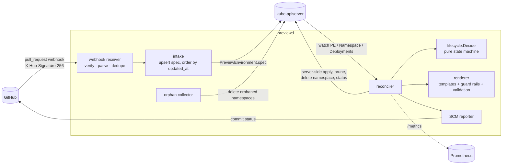

# previewd

**Ephemeral preview environments for pull requests, as a Kubernetes
controller.** previewd receives signed GitHub-format `pull_request` webhooks,
renders a namespace per PR with a ResourceQuota, LimitRange, NetworkPolicies,
Pod Security labels, a TTL label and the app manifests from a template set,
reconciles it with a level-triggered state machine, posts commit statuses
back through a mockable SCM client, and garbage-collects everything on close,
on TTL expiry, or when its record disappears.

It is written in Go on controller-runtime, tested against a real
kube-apiserver with envtest, and runs fully offline in a demo.

> Portfolio project. It has never run against a production cluster or a
> real GitHub organisation; see [Limitations](#limitations).

## Who it is for

Platform teams that want "every PR gets a URL" without running a full GitOps
stack, and that care about the boring parts: idle previews disappearing on
their own, namespaces actually being deleted, PR-controlled text not being
able to escape its namespace, and reviewers seeing the state on the PR. If you
already run Argo CD, read [docs/COMPARISON.md](docs/COMPARISON.md) first —
the ApplicationSet Pull Request generator may be the better choice.

## Architecture



* The **webhook path only records desired state** (a `PreviewEnvironment`
  per PR). It never touches namespaces or the SCM, so it is fast and safe to
  retry.
* The **reconciler** observes the world, asks a pure function what to do
  (`internal/lifecycle`), does it, and records the result. Because the
  decision depends only on current state, missed events, duplicates and
  restarts all reduce to "observe again".
* **Rendering** produces a deterministic bundle with a content hash; a
  changed hash means "apply", an unchanged one means "do nothing".

Phases: `Pending → Provisioning → Ready`, `Failed` (with backoff),
`TearingDown → Closed | Expired`, and back to `Provisioning` on reopen or a
new push. Details, the full decision table and complexity analysis are in
[docs/ARCHITECTURE.md](docs/ARCHITECTURE.md).

## Quickstart

Requirements: Go 1.26+, `make`, and (for the tests and demo) the envtest
binaries, which `make` fetches once with the pinned `setup-envtest` tool.
No Docker, no cluster, no network after the first download.

```bash
make check     # gofmt, generated-code check, go vet, golangci-lint, tests (incl. envtest, -race), coverage floor
make demo      # offline end-to-end run against a local kube-apiserver
make build     # bin/previewd
```

Render a template set without a cluster:

```bash
bin/previewd render --repo acme/shop --pr 42 \
  --sha 4f2a9c1e0b7d3a5f6c8e9d0a1b2c3d4e5f6a7b8c --title "Checkout v2" | head -3
# previewd render: template=default namespace=pr-shop-42 objects=11 hash=… url=https://pr-shop-42.preview.example.test ttl=72h0m0s
```

Run against a cluster (from your kubeconfig):

```bash
kubectl apply -k config/            # CRD, ClusterRole, previewd-system Deployment (build and set your own image first;
                                    # the Deployment also expects the previewd-secrets Secret and the
                                    # previewd-template-default ConfigMap described in config/manager/manager.yaml)
export PREVIEWD_WEBHOOK_SECRETS='a-long-random-secret' GITHUB_TOKEN='…'
bin/previewd serve --repos 'acme/*' --templates-dir templates --required-label preview
```

Point a GitHub webhook (content type `application/json`, the same secret,
event "Pull requests") at `http://<host>:8090/webhook`. `previewd serve -h`
lists every flag; `.env.example` lists the environment variables.

### Template sets

A template set is a directory with `templateset.yaml` (namespace prefix, TTL,
host pattern, quota, limit range, network policy, allowed kinds, service
types, Pod Security level, static vars) and `manifests/*.yaml` Go templates.
Two are bundled: [`templates/default`](templates/default) (web Deployment,
Service, Ingress, ConfigMap) and [`templates/static-site`](templates/static-site)
(restricted PSA, 24h TTL, a worker that only exists while the PR carries the
`preview:worker` label). PR text must go through `quote`:

```yaml
data:
  PR_TITLE: {{ quote .PR.Title }}
```

## Demo

`make demo` starts a real kube-apiserver and etcd (envtest), a fake GitHub
status API, and previewd itself, then replays signed webhook fixtures. envtest
runs no controllers, so a small simulator marks Deployments available and
finalizes deleted namespaces; the demo's clock is fake so it can fast-forward
through the 72h TTL. Output from a real run (`make demo`, trimmed only where
marked):

```text
== 1. GitHub pings the webhook, then an attacker posts an unsigned payload
   signed   delivery=d-01     ping         -> HTTP 200 {"status":"pong"}
   UNSIGNED delivery=d-02     pull_request -> HTTP 401 {"status":"invalid signature"}

== 2. PR #42 opened (signed delivery)
   signed   delivery=d-03     pull_request -> HTTP 202 {"status":"created","instance":"acme-shop-pr-42"}
   phase -> Provisioning applying rendered bundle
   phase -> Ready        all workloads available
   reached Ready in 153ms (url=https://pr-shop-42.preview.example.test, objects=11, sha=4f2a9c1)
   namespace pr-shop-42 labels: pod-security.kubernetes.io/enforce=baseline pod-security.kubernetes.io/warn=baseline previewd.dev/expires-at=1791104400 previewd.dev/instance=acme-shop-pr-42 previewd.dev/pr=42 previewd.dev/repo=acme.shop
   objects: ResourceQuota/previewd-quota, LimitRange/previewd-limits, ConfigMap/preview-info, Service/web, Deployment/web, NetworkPolicy/previewd-allow-egress, NetworkPolicy/previewd-allow-ingress-namespaces, NetworkPolicy/previewd-allow-same-namespace, NetworkPolicy/previewd-default-deny, Ingress/web

== 3. new commit pushed; GitHub redelivers it; an older delivery arrives late
   signed   delivery=d-04     pull_request -> HTTP 202 {"status":"updated","instance":"acme-shop-pr-42"}
   signed   delivery=d-04     pull_request -> HTTP 200 {"status":"duplicate"}
   signed   delivery=d-05     pull_request -> HTTP 202 {"status":"stale","instance":"acme-shop-pr-42","reason":"event older than 2026-10-01T09:20:00Z"}
   reached Ready on 9e8d7c6 in 119ms (url=https://pr-shop-42.preview.example.test, objects=11, sha=9e8d7c6)

== 4. events previewd ignores: an assignment, and a PR from a fork
   signed   delivery=d-06     pull_request -> HTTP 202 {"status":"ignored","reason":"action \"assigned\" does not affect previews"}
   signed   delivery=d-07     pull_request -> HTTP 202 {"status":"ignored","reason":"pull request from fork mallory/shop (forks disabled)"}

== 5. nobody touches the PR for 72h: TTL expiry
   (fast-forwarding the controller clock by 72h0m0s to 2026-10-04T09:25:00Z)
   phase -> TearingDown  TTL elapsed at 2026-10-04T09:20:00Z; waiting for namespace deletion
   phase -> Expired      TTL elapsed at 2026-10-04T09:20:00Z

== 6. a new push revives the expired preview
   signed   delivery=d-08     pull_request -> HTTP 202 {"status":"updated","instance":"acme-shop-pr-42"}
   phase -> Provisioning applying rendered bundle
   reached Ready on c0ffee0 in 135ms (url=https://pr-shop-42.preview.example.test, objects=11, sha=c0ffee0)

== 7. PR merged and closed
   phase -> TearingDown  pull request closed; waiting for namespace deletion
   phase -> Closed       pull request closed

== 8. retention (1h) elapses: the record deletes itself
   PreviewEnvironment acme-shop-pr-42 deleted

== 9. orphan collection: a preview namespace whose record was force-deleted
   collector deleted: [pr-legacy-7]

== 10. commit statuses GitHub received (POST /repos/{owner}/{repo}/statuses/{sha})
   /repos/acme/shop/statuses/4f2a9c1        pending  Preview environment is being provisioned
   /repos/acme/shop/statuses/4f2a9c1        success  Preview environment is ready
   /repos/acme/shop/statuses/9e8d7c6        pending  Preview environment is being provisioned
   /repos/acme/shop/statuses/9e8d7c6        success  Preview environment is ready
   /repos/acme/shop/statuses/9e8d7c6        error    Preview expired (TTL); push a commit to recreate it
   /repos/acme/shop/statuses/c0ffee0        pending  Preview environment is being provisioned
   /repos/acme/shop/statuses/c0ffee0        success  Preview environment is ready
   /repos/acme/shop/statuses/c0ffee0        success  Preview environment removed

== 11. Prometheus metrics (previewd_* excerpt from /metrics)   [trimmed to a few lines here]
   previewd_phase_transitions_total{from="Provisioning",to="Ready"} 3
   previewd_scm_status_reports_total{result="ok",state="pending"} 3
   previewd_webhook_requests_total{event="pull_request",outcome="stale"} 1
   previewd_webhook_requests_total{event="pull_request",outcome="unauthorized"} 1
```

(A few repeated `phase ->` lines were also trimmed in steps 3–7; the full
output is in the build report.)

## Design decisions

The full list with trade-offs is in [DECISIONS.md](DECISIONS.md). The ones
that shape everything else:

* **Edge in, level out.** Webhooks are edges; the controller is level-
  triggered. The intake writes desired state ordered by the PR's
  `updated_at`, so late, duplicated or replayed deliveries cannot roll a
  preview back.
* **A pure state machine.** `lifecycle.Decide(Observation) Decision` holds
  all lifecycle logic; property tests drive it from 5,000 random states
  through a simulated cluster and check convergence, no repeated statuses and
  "teardown never re-applies".
* **Server-side apply + label-based pruning + content hash.** A reconcile of
  a converged environment makes two uncached GETs, a few cache reads and no
  writes — verified
  against a real API server by comparing every object's `resourceVersion`
  across five extra reconciles.
* **Guard rails are not optional.** Quota, limits, default-deny network
  policy and Pod Security labels come from template-set config; rendered
  objects must be allowlisted kinds in the preview namespace, without host
  access or privileged containers. RBAC and cluster-scoped kinds can never
  be allowed.
* **Never touch what you did not create.** A namespace without previewd's
  labels is never adopted or deleted, even if its name matches.
* **TTL without a sweeper.** `Ready` reconciles requeue exactly at expiry; the
  expiry label lives outside the bundle so PR activity extends the TTL
  without re-applying anything.

## Tests, coverage and benchmarks

Every number below comes from the command shown next to it, run on the build
machine (Apple silicon, 8 cores, shared with other builds — expect variance).

| What | Command | Result |
|---|---|---|
| All gates | `make check` | pass: fmt, generate check, vet, golangci-lint (0 issues), 12 test packages, coverage floor |
| Coverage, `./internal/...` | `make check` (then `make cover-report`) | **94.8%** of statements (1401/1478) |
| Lowest packages | `make cover-report` | app 81.8%, cli 84.7%, controller 88.6% |
| Envtest integration tests | `go test ./internal/controller ./internal/app` (via `make test`) | 15 tests against kube-apiserver 1.37.0 |
| Property tests | `go test ./internal/lifecycle` | 2 properties, 5,000 random starting states each |
| Fuzzing | `make fuzz` | `FuzzNamespaceIsAlwaysValid`, `FuzzVerifyNeverPanics` (30s each) |
| `lifecycle.Decide` | `make bench` | 38 ns/op, 1 alloc |
| Signature verify, 25 KiB body | `make bench` | 11.1 µs/op (2.3 GB/s) |
| Parse `pull_request` fixture | `make bench` | 5.2 µs/op, 4 allocs |
| Render default template set | `make bench` | 192 µs/op, 2,088 allocs |
| 50 PRs opened concurrently: webhook response | `make bench-scale` | p50 34 ms, p95 43 ms |
| 50 PRs: delivery → Ready | `make bench-scale` | p50 1.32 s, p95 1.50 s |
| 50 PRs closed: delivery → Closed | `make bench-scale` | p50 171 ms, p95 310 ms |

Coverage is measured with `-coverpkg=./internal/...` in a single run, so a
package's figure includes statements exercised by other packages' tests
(e.g. the controller is also driven by the end-to-end test in
`internal/app`). The scale run is against envtest — no kubelet, no images —
so "Ready" means the simulator marked Deployments available; it measures
previewd and the API server, not container start-up. A previous scale run on
the same machine measured delivery → Ready p50 2.9 s; treat these as
order-of-magnitude figures.

## Limitations

* **Never run in production.** All Kubernetes testing is envtest (real
  apiserver + etcd, no controllers, no nodes). Readiness and namespace
  finalization were simulated; container start-up, image pulls, real network
  policy enforcement and PSA admission of real pods were not exercised.
* **GitHub only, commit statuses only.** No GitLab/Bitbucket intake, no
  GitHub Deployments API, no GitHub App authentication (a long-lived token
  is used). The GitHub client was tested against an `httptest` server, not
  api.github.com.
* **No Helm or Kustomize.** Templates are Go `text/template` YAML.
* **Health checks cover Deployments and StatefulSets only.**
* **No drift correction for unchanged bundles.** previewd re-applies when the
  rendered hash changes or the namespace is missing; manual edits to objects
  in an unchanged environment are not reverted until the next change.
* **Broad RBAC.** Dynamic namespaces force cluster-wide verbs on the
  allowlisted namespaced kinds (including Secrets); see
  [docs/THREAT_MODEL.md](docs/THREAT_MODEL.md).
* **Pruning lists every allowed kind** on each apply (9 LISTs with the
  default allowlist).
* **First write after start-up is slow.** In the scale run the first
  delivery took ~2 s; the time is spent inside controller-runtime v0.25's
  client write path before the first create (measured, not investigated
  further). Later deliveries take tens of milliseconds.
* **The delivery-ID cache is per replica and in memory.**
* **CI is written but has never run**: the repository has not been pushed.
* **No container image or Dockerfile** is provided; the manifests in
  `config/` reference `previewd:dev` and were validated only by server-side
  dry-run against envtest (`TestDeployManifestsAreValid`).

## Roadmap

* GitHub App authentication and the Deployments API (environment URL panel).
* GitLab and Gitea intake behind the same `intake.Event`.
* Optional Argo CD `Application` output so previewd can own lifecycle while
  Argo CD owns sync (see [docs/COMPARISON.md](docs/COMPARISON.md)).
* A ValidatingAdmissionPolicy that confines previewd's ServiceAccount to
  managed namespaces.
* Periodic re-apply to correct drift; health checks for Jobs and custom
  resources.
* Status inventory to replace per-kind prune LISTs.

## Repository map

```
api/v1alpha1/          PreviewEnvironment CRD types (+ generated deepcopy)
cmd/previewd/          main: serve | render | sign | version
cmd/previewd-demo/     offline demo and 50-PR scale run (envtest + fake GitHub)
config/                CRD, generated ClusterRole, manager Deployment, sample, kustomization
internal/lifecycle/    pure state machine + property tests
internal/render/       template sets, guard rails, validation, golden tests
internal/controller/   reconciler + envtest integration suite
internal/webhook/      HMAC verification, parsing, delivery cache, HTTP server
internal/intake/       idempotent PreviewEnvironment upsert
internal/scm/          Reporter interface, GitHub client, recorder
internal/gc/           orphan namespace collector
internal/app/          manager wiring + end-to-end envtest
templates/             bundled template sets
testdata/webhooks/     synthetic signed-payload fixtures
docs/                  ARCHITECTURE, COMPARISON (Argo CD), THREAT_MODEL
```

## License

MIT — see [LICENSE](LICENSE).
