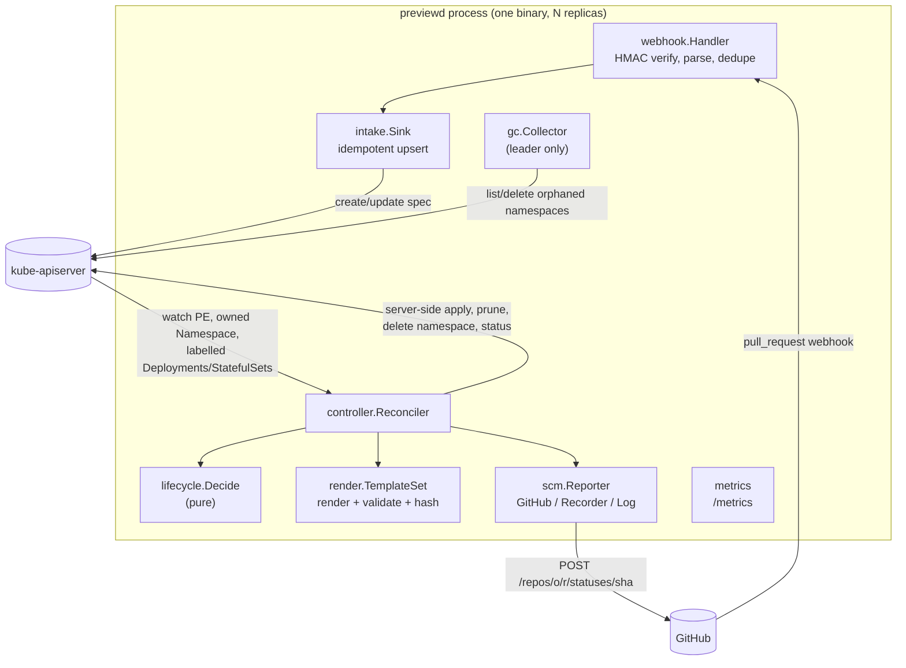
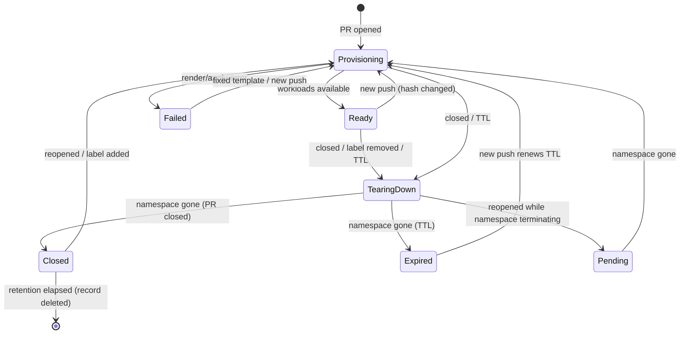

# previewd architecture

This document goes one level below the README: the data model, the state
machine, how a reconcile works step by step, the rendering and validation
pipeline, the webhook path, and the cost of each piece.

## Components

| Package | Responsibility | Depends on |
|---|---|---|
| `api/v1alpha1` | `PreviewEnvironment` CRD types (cluster-scoped), labels/annotations | apimachinery |
| `internal/naming` | deterministic DNS-safe names for instances and namespaces | — |
| `internal/lifecycle` | pure state machine: `Observation -> Decision` | api |
| `internal/render` | template sets, guard rails, validation, bundle hash | api, naming |
| `internal/webhook` | signature verification, payload parsing, delivery cache, HTTP server | intake, metrics |
| `internal/intake` | event -> `PreviewEnvironment` spec (no side effects beyond that) | api, naming |
| `internal/controller` | the reconciler: observe, decide, act, record | lifecycle, render, scm, metrics |
| `internal/scm` | `Reporter` interface; GitHub commit-status client; in-memory recorder | lifecycle |
| `internal/gc` | orphan namespace collector | api, metrics |
| `internal/config` | flags + environment -> validated `Config` | intake, scm, webhook |
| `internal/app` | wires everything into a controller-runtime manager | all of the above |
| `internal/cli` | `serve`, `render`, `sign`, `version` | app, config, render |

## Data model

One cluster-scoped `PreviewEnvironment` (PE) per pull request, named
`<owner>-<repo>-pr-<n>` (DNS label, hashed if too long, `internal/naming`).

* **spec** is written by the webhook intake (or by hand): repository, PR
  facts (number, head SHA, refs, author, title, labels, draft), `state`
  (`open|closed`), `template`, optional `ttl` override, and
  `lastActivityTime` (the SCM's `updated_at` of the newest applied event).
* **status** is written only by the reconciler: `phase`, `namespace`, `url`,
  `expiresAt`, `appliedHash`/`appliedSHA`, `resources`, `lastReported`
  (SHA + state of the last *successfully* posted SCM status),
  `terminatedAt`, `failureCount`, `message`, `observedGeneration` and the
  conditions `Rendered`, `Applied`, `Ready`.

The PE is cluster-scoped because it owns a Namespace: Kubernetes only allows
owner references from cluster-scoped owners to cluster-scoped dependents.
The namespace carries a controller owner reference to the PE, so the
Kubernetes garbage collector is a second line of defence if previewd is
uninstalled.

## The state machine

`lifecycle.Decide` is a pure, total function. It sees only the current
observation — never history — which is what "level-triggered" means here:
crashes, dropped watch events, duplicate deliveries and controller restarts
all reduce to "observe again and decide again".

Inputs (`Observation`): now, deleting?, wanted? (open and passing gates),
expiresAt, namespace state (Absent / Active / Terminating), render error,
desired hash, applied hash, workloads ready?, head SHA, last reported
status, terminatedAt, failure count, retention, poll interval.

Decision table (first matching row wins):

| # | Condition | Phase | Effects | Requeue |
|---|---|---|---|---|
| 1 | deleting, namespace Active | TearingDown | delete namespace | poll |
| 2 | deleting, namespace Terminating/Absent | TearingDown | release finalizer | — |
| 3 | not wanted or TTL elapsed, namespace Active | TearingDown | delete namespace | poll |
| 4 | ... namespace Terminating | TearingDown | — | poll |
| 5 | ... namespace Absent | Closed / Expired | report inactive/expired; mark terminatedAt; delete self after retention | until retention |
| 6 | wanted, namespace Terminating (reopen) | Pending | — | min(poll, ttl) |
| 7 | wanted, render failed | Failed | report failed; failureCount+1 | backoff 5s·2ⁿ, cap 5m |
| 8 | wanted, namespace Absent or hash changed | Provisioning | apply + prune; report pending | min(poll, ttl) |
| 9 | wanted, applied, workloads not ready | Provisioning | report pending | min(poll, ttl) |
| 10 | wanted, applied, ready | Ready | report ready | exactly until TTL |

Reports are emitted only when `(headSHA, state)` differs from
`status.lastReported`, so a converged environment produces no SCM traffic.
Rows 5 and 10 schedule the next wake-up at the exact moment something will
change (retention end, TTL expiry), so expiry needs no periodic sweeper.

**Properties checked by tests** (`internal/lifecycle/lifecycle_test.go`):

* *Convergence:* from 5,000 random starting states, running Decide and a
  simulated cluster reaches a quiet fixed point (no mutating effects) within
  30 steps, and the fixed point is the phase the inputs call for (Ready,
  Failed, Closed or Expired).
* *No duplicate statuses:* the same `(sha, state)` is never posted twice in
  a row.
* *Safety:* a closed, expired or deleted environment is never (re)applied.

The envtest suite then checks the same idempotence against a real API
server: after convergence, five more reconciles leave every object's
`resourceVersion` unchanged and post no statuses
(`TestReconcileIsIdempotent`).

## One reconcile, step by step

`internal/controller/reconciler.go`:

1. **Read** the PE through the uncached API reader. A reconcile triggered by
   an owned-object event can otherwise see a cached PE that lacks the status
   the previous reconcile wrote, and would re-post a status.
2. **Finalizer**: add `previewd.dev/teardown` if missing.
3. **Observe**: resolve the template set and TTL
   (`spec.ttl` > template `ttl` > 72h), compute `expiresAt =
   lastActivityTime + ttl`, render the bundle if the environment is wanted,
   read the namespace uncached (so a namespace previewd does not manage is
   never mistaken for absent), and check workload readiness from the
   label-filtered cache.
4. **Decide** with `lifecycle.Decide`.
5. **Act**: server-side apply (field manager `previewd`, force) the
   namespace and every object; prune; maintain the expiry label; delete the
   namespace; post the SCM status. An apply error turns the decision into
   `Failed` with backoff (and posts `failed` instead of `pending`).
6. **Record**: merge-patch status and conditions, update the phase gauge,
   count the transition, emit a Kubernetes Event.
7. **Finish**: release the finalizer or delete the record if decided,
   otherwise return `RequeueAfter`.

### Foreign namespaces

If the computed namespace exists but is not labelled as this PE's, previewd
treats it as foreign: provisioning fails with a clear message, and teardown
treats it as absent. previewd never adopts or deletes a namespace it did not
create (`TestForeignNamespaceIsNeverAdoptedOrDeleted`).

### Pruning

Every object carries `previewd.dev/instance=<pe>`. After applying, the
reconciler lists each kind the template catalog allows in the preview
namespace by that label and deletes anything not in the current bundle
(e.g. a worker Deployment enabled by a PR label that has since been
removed — `TestNewPushReappliesAndPrunes`). Kinds the cluster does not serve
are skipped (`NoKindMatch`).

### The TTL label

The namespace carries `previewd.dev/expires-at=<unix seconds>` so humans and
other tools can see the deadline. It is applied by a second field manager
(`previewd-ttl`), outside the bundle: TTL moves on every PR event, and if it
were part of the rendered bundle every label or title edit would re-apply
everything and flip the commit status back to `pending`
(`TestActivityExtendsTTLWithoutReapply`).

## Rendering pipeline

`internal/render`:

1. **Load** a template set: `templateset.yaml` (strictly decoded; quantities
   and kinds validated at load time) plus `manifests/*.yaml` parsed as Go
   `text/template` with `missingkey=error` and a small audited function map
   (`quote`, `dnsLabel`, `labelValue`, `lower`, `upper`, `trunc`, `default`,
   `replace`, `join`, `has`).
2. **Values**: namespace, host/URL (from the `host` template), repo and PR
   facts, plus pre-sanitised slugs. PR-controlled text (titles, branch names)
   must go through `quote`, which JSON-encodes and therefore cannot break out
   of a YAML scalar.
3. **Execute and decode** each template into YAML documents (numbers decode
   as `int64`, matching what the API server returns).
4. **Validate** every object: kind on the allowlist (RBAC and
   cluster-scoped kinds can never be allowed), namespace empty or equal to
   the preview namespace, valid name, no `generateName`, Service type
   allowed (ClusterIP only by default, so previews never allocate cloud load
   balancers), and pod templates free of `hostNetwork/hostPID/hostIPC`,
   `hostPath`, `hostPort`, privileged containers and dangerous capabilities.
   Duplicate objects are rejected.
5. **Stamp** common labels and the head-SHA annotation, pin the namespace.
6. **Guard rails**: ResourceQuota, LimitRange, default-deny NetworkPolicy,
   allow-same-namespace, allow-from-ingress-namespaces, and (optionally)
   restricted egress (DNS to kube-system, same namespace, listed CIDRs).
   The namespace gets Pod Security Admission `enforce`/`warn` labels.
7. **Order** objects for apply (quota → limits → policies → service
   accounts → secrets → config → PVCs → services → workloads → ingress) and
   **hash** the canonical JSON (Go's encoder sorts map keys) of everything.

## Webhook path

`internal/webhook` + `internal/intake`:

1. Method must be POST; body capped (1 MiB default) before anything else.
2. `X-Hub-Signature-256` verified with HMAC-SHA256 against every configured
   secret using `hmac.Equal` (constant time); all secrets are always tried.
3. `ping` → 200; other non-`pull_request` events → 202 ignored.
4. Delivery IDs seen recently → 200 `duplicate` (bounded LRU + TTL). IDs are
   recorded only after successful processing so failed deliveries can be
   redelivered.
5. Payload parsed; irrelevant actions and fork PRs (unless allowed) → 202
   ignored; invalid payloads → 400.
6. Intake: repository rules (`owner/*=template`), then upsert with
   `RetryOnConflict`. Events whose `updated_at` is older than
   `spec.lastActivityTime` are `stale` and do not write — this is what
   orders out-of-order and replayed deliveries. Closed events for unknown
   PRs are ignored. A PE that is mid-deletion returns 503 so the sender
   retries.

The handler never touches namespaces or the SCM; it only records desired
state. That keeps webhook latency low (p50 44 ms in the scale run below) and
makes every side effect retryable by the reconciler.

## Complexity

Let *k* be the number of objects in a bundle, *K* the number of kinds the
catalog allows, *b* the payload size and *P* the number of preview
environments.

| Operation | Time | Space | Notes |
|---|---|---|---|
| `lifecycle.Decide` | O(1) | O(1) | 39 ns/op (`make bench`) |
| signature verify | O(b · secrets) | O(1) | 12.3 µs for 25 KiB (`make bench`) |
| payload parse | O(b) | O(b) | 5.5 µs for the fixture |
| render + validate + hash | O(k log k + template size) | O(k) | 201 µs, 2,114 allocs for the default set |
| reconcile (apply) | O(k) API calls + O(K) list calls | O(k) | one SSA per object, one LIST per allowed kind |
| reconcile (converged) | 2 GETs + readiness GETs from cache | O(k) | no writes |
| orphan sweep | O(namespaces + P) | O(P) | leader only, every 5 min |
| delivery cache | O(1) per op | O(capacity) | default 10,000 IDs |

Informer memory is bounded by previews, not cluster size: the manager caches
only Namespaces, Deployments and StatefulSets carrying
`app.kubernetes.io/managed-by=previewd`, plus PreviewEnvironments.
